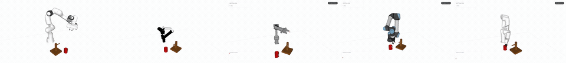
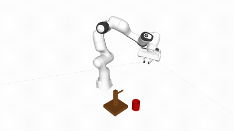
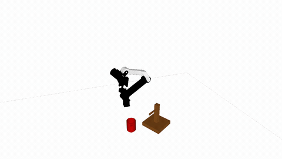
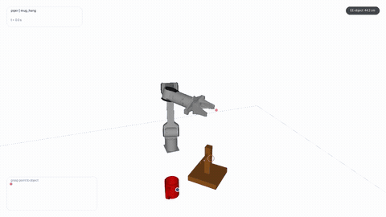
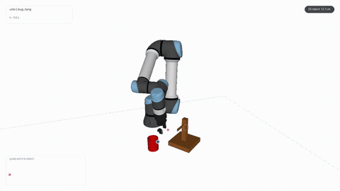
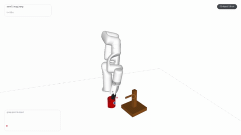

<div align="center">

# 🦾 Embodied-SuperMimic

### 让机械臂在世界模型中学习，在仿真中验证。

## 🌐 [打开在线实验展示](https://fbddcz.github.io/Embodied-SuperMimic/)

[](https://fbddcz.github.io/Embodied-SuperMimic/)
[](https://github.com/FBddcz/Embodied-SuperMimic/stargazers)

**🎬 看机械臂执行 · 🔎 切换本体与策略 · 🧠 了解在线世界模型 · 📖 查结果与协议**

无需安装，打开就能看。选择 Panda、ARX5、PiPER、UR5e 或 xArm7，暂停、拖动进度，观察动作与接触。

[🎥 看录像](https://fbddcz.github.io/Embodied-SuperMimic/#gallery) · [🚀 本地启动](#quickstart) · [📊 实验结果](#results) · [🧪 复现说明](docs/REPRODUCIBILITY.md)

<a href="https://fbddcz.github.io/Embodied-SuperMimic/#gallery"></a>

**一个独立的机器人操作研究项目。** 从各机器人自己的任务专家出发，探索在线世界模型与策略如何共同改进。

</div>

## ✨ 这里可以看什么？

- **真实保存的仿真录像**：挂杯、柠檬放置；五种机器人、八组策略演示，按本体和任务一键筛选。
- **不同策略的动作**：Teacher、BC 初始化、在线 Dyna 分开标注，方便逐段观察。
- **看得见的运动过程**：HUD 叠加历史姿态、末端轨迹与目标距离，让接触操作更容易看懂。
- **可追溯的研究结果**：公开成功计数、训练种子和预算说明，保留未完成与失败项。

## 🎬 五种机械臂，循环看动作

| Panda · Dyna | ARX5 · Teacher | PiPER · Teacher |
|:---:|:---:|:---:|
| [](https://fbddcz.github.io/Embodied-SuperMimic/static/videos/rollouts/panda/mug_hang/panda_mug_v7_final.mp4) | [](https://fbddcz.github.io/Embodied-SuperMimic/static/videos/rollouts/arx5/mug_hang/teacher.mp4) | [](https://fbddcz.github.io/Embodied-SuperMimic/static/videos/rollouts/piper/mug_hang/verified_20261104/teacher_hud.mp4) |

| UR5e · Teacher | xArm7 · Teacher |
|:---:|:---:|
| [](https://fbddcz.github.io/Embodied-SuperMimic/static/videos/rollouts/ur5e/mug_hang/verified_20261104/teacher_hud.mp4) | [](https://fbddcz.github.io/Embodied-SuperMimic/static/videos/rollouts/xarm7/mug_hang/verified_20261104/teacher_hud.mp4) |

*选定仿真片段的循环动图，点击看原视频。顶部为五路独立循环拼接；[完整录像库](https://fbddcz.github.io/Embodied-SuperMimic/#gallery) 支持按机器人和任务筛选。*

## 🧭 选一条路径开始

| 你想做什么 | 从这里开始 | 需要什么 |
|---|---|---|
| **现在看演示** | [打开在线录像库](https://fbddcz.github.io/Embodied-SuperMimic/#gallery) | 浏览器 |
| **本地运行网页** | [三行命令启动](#quickstart) | Git、Python 3.9+ |
| **了解研究复现** | [复现指南与实验设置](docs/REPRODUCIBILITY.md) | 网页与结果已公开；训练代码、模型与复位库尚未发布 |

<a id="quickstart"></a>
## 🚀 本地启动，就这几步

```bash
git clone https://github.com/FBddcz/Embodied-SuperMimic.git
cd Embodied-SuperMimic
python3 scripts/serve.py --port 8765
```

打开 **http://127.0.0.1:8765/#gallery**。不需要 GPU、API Key、npm 或 pip 安装。Windows 可把 `python3` 换成 `py -3`；端口占用时换成 `--port 8766`。服务只监听本机，`Ctrl+C` 停止。

<details>
<summary>🔧 修改网页与检查文件</summary>

```bash
python3 scripts/check_site.py
python3 scripts/test_preview.py
node --check site/static/js/gallery.js
```

前两项仅用 Python 标准库；最后一项需要 Node.js。修改公开文件后同步更新 `site/release-manifest.json` 的大小与 SHA256。入口是 `site/index.html`，播放器逻辑在 `site/static/js/gallery.js`。

[本地预览指南](docs/QUICKSTART.md) · [贡献流程](CONTRIBUTING.md)

</details>

## 🧠 它在研究什么？

**从自己的新经验中继续学习。** 策略在仿真中行动，世界模型不断吸收新转移，再通过可微想象轨迹更新策略。每个机器人与任务有自己的专家；当前策略使用状态观测，v7 从教师模型和 BC 策略初始化后继续在线学习。

我们关心的不只是“预测得准不准”，还包括“持续更新世界模型，是否让策略学得更好”。方法来源与完整比较设置见 [实验说明](docs/EXPERIMENTS.md)。

<a id="results"></a>
## 📊 看看它学得怎么样

**挂杯任务的历史结果**，Teacher 与在线 Dyna 分列：

| 机器人 | Teacher | Dyna @3000 | Dyna @4000 | Dyna 训练 seed |
|---|---:|---:|---:|---:|
| Panda | 79.3% | 87.1 ± 8.1% | — | 3 |
| ARX5 | 97.7% | 98.1 ± 1.4% | — | 3 |
| PiPER | 46.1% | 85.94% | 92.97% | 1 |
| UR5e | 62.5% | 68.75% | 69.92% | 1 |
| xArm7 | 46.5% | 51.95% | 57.81% | 1 |

> **历史四类混合起点评测**（`legacy_reset_v0`，256 集/检查点），非 HOME 全流程分数。预算和训练 seed 分列；教师与 BC 成本另计。<span id="home-live-status"><code>home_fulltask_v1</code> 开发诊断已覆盖 14 格（mug_hang 5、lemon 5、square 4），每格 16 个独立场景并带重复评测；开发诊断不等于正式 HOME 成绩。25 格中已有 14 格训练出教师，drawer/box 仍 blocked。</span>，完整设置见 [实验说明](docs/EXPERIMENTS.md)。

**HOME 全流程开发诊断**（`home_fulltask_v1`，16 场景/格，教师 checkpoint，确定性策略；成功判据与时限未放宽，非官方 HOME 成绩）：

| 任务 | Panda | ARX5 | PiPER | UR5e | xArm7 |
|---|---|---|---|---|---|
| 挂杯 | 12/16 | 7/16 | 1/16 | 9/16 | 7/16* |
| 柠檬 | 15/16 | 0/16† | 8/16 | 16/16 | 16/16* |
| 方螺母插入 | 0/16 | 0/16 | blocked（采样） | 0/16† | 0/16 |

> *xArm7 延训到 8000 iter 后：挂杯从 1/16 到 7/16；柠檬从 2/4/3/16 到 16/16×3。Panda 挂杯两次为 11/16、12/16；UR5e 柠檬三次为 16/16、16/16、15/16。†整格 16 回合均为 joint-limit violation，属配置限制，如实计入分母、不算成功。**Square**：reset-audit 修复后 Panda/ARX5/UR5e/xArm7 的全量 bank 与教师均完成，但 HOME 开发诊断全为 0/16；补采 near-peg/above-peg 插入阶段课程（v2 bank）并重训 4000 iter 后，训练仍只学会"已穿入"起点（type-3 末段 14.6%，其余类别≈0），HOME 仍 0/16——这是已定位的开放问题，奖励/课程是下一步，未降低成功判据。

UR5e / xArm7：HOME 开发诊断已在上表给出；两臂部分格出现 joint-limit 骑限，属配置限制并如实计入分母；旧版随机起姿评测结果保留在历史表中。

<details>
<summary>🔎 计数、控制组与完整 25 格状态</summary>

- PiPER：220/256 @3000、238/256 @4000；UR5e：176/256、179/256。
- @3000/@4000 含初始化计数 1000，约为 2000/3000 新增在线迭代；教师预训练与 BC 成本另外计算，跨机器人配置不同。
- 录像保留 Teacher / BC / Dyna 标签。所选成功片段不代替整体评测；部分旧片为中途起点，三条长片按真实控制时间播放，其余标为 legacy capture。蓝色残影为历史姿态。
- 最终 legacy 广范围随机 type-0：UR5e 0/64、xArm7 1/64；不能据此推断硬件上限。
- 同初始化冻结模型控制：Panda 38.4 ± 7.9%（3 seed）；ARX5 39.8 ± 12.7%（2 个完成、1 个发散）。
- **5 本体 × 5 任务是目标**：正式历史教师 8/25；现已训练教师 14/25（mug 5、lemon 5、square 4）；HOME 开发诊断 14 格完成。环境契约 25/25 不等于任务完成。新增开发库 6 通过、9 阻塞，未完成项不写成 0%。
- Square 的 bank 在 reset-audit 修复后四臂采满并完成教师；插入阶段 v2 bank 修复了课程缺口，但 4000 iter 仍只学会已穿入起点，HOME 0/16，列为开放问题。
- 任务为挂杯、柠檬放置、方螺母插入、预打开抽屉的放物并关抽屉、盒子入箱。drawer **不含开抽屉**。

[完整协议与逐格状态](docs/EXPERIMENTS.md) · [机器可读结果](results/mainline.json) · [新 HOME 协议概要](docs/EXPERIMENTS.md#home_fulltask_v1)

</details>

## 📚 按需查文档

| 文档 | 解决什么问题 |
|---|---|
| [快速上手](docs/QUICKSTART.md) | 本地怎么启动、怎么改页面 |
| [实验与协议](docs/EXPERIMENTS.md) | 分数如何计算、哪些能比较 |
| [复现说明](docs/REPRODUCIBILITY.md) | 目前能复现什么、后续还缺什么 |
| [发布记录](docs/RELEASE_STATUS.md) | 已验证的发布快照与检查范围 |
| [来源与许可](THIRD_PARTY_NOTICES.md) | 上游、机器人模型与素材归属 |

## 🤝 一起把研究做得更清楚

欢迎报告播放问题、讨论实验设置、分享失败案例。请附机器人、任务、协议和复现步骤，见 [贡献指南](CONTRIBUTING.md)。如果这些演示对你有帮助，欢迎点一颗 **⭐ Star**，让更多人发现这个项目。

## ⭐ Star History

感谢每一份关注与反馈，让更多人一起探索机械臂世界模型。图表随 Star History 服务刷新，点击可查看交互页面。

[](https://star-history.com/#FBddcz/Embodied-SuperMimic&Date)

## 🙏 致谢

基于 [emoPointer/supermimic_manipulation](https://github.com/emoPointer/supermimic_manipulation) 与 [SuperMimic](https://supermimic.github.io/)，感谢 mjlab、MuJoCo 与 MuJoCo Menagerie 社区。独立的仿真研究项目。

模型、素材与代码的归属和复用条件见 [第三方来源与许可](THIRD_PARTY_NOTICES.md)。
